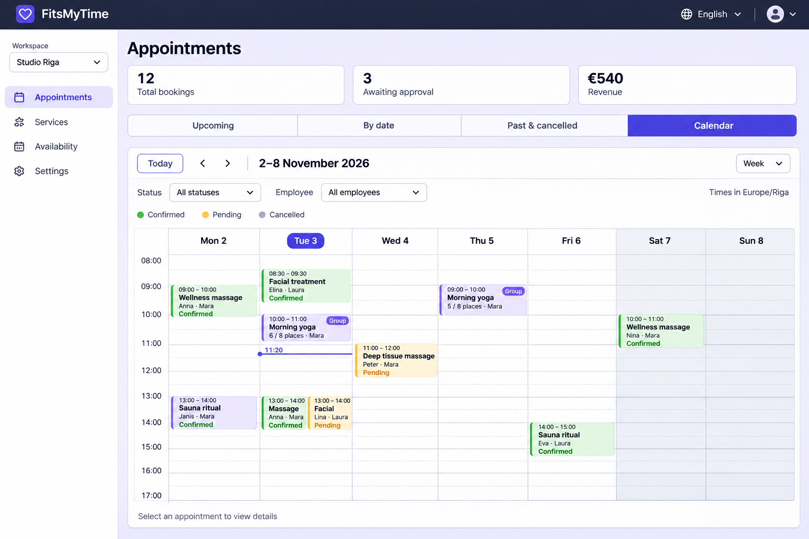

# Provider appointment calendar proposal — 3 November 2026

Status: approved and implemented locally; see the
[implementation handoff](appointment-calendar-handoff.md) for actual verification.
User assigned this
Front End planning task for `/my-services/appointments` and requested an example
picture inspired by the supplied Outlook/Teams weekly calendar. Executor: `/root`.
This record covers repository review, design and planning artifacts only.

The built-in image-generation tool produced this conceptual screenshot using
[this prompt](designs/appointment-calendar-v1.prompt.txt). Names, counts, amounts
and times are illustrative. Keep existing summary calculations and currency
formatting during implementation; this picture does not propose a currency change.

## Recommended behavior

- Add **Calendar** as a fourth view alongside Upcoming, By date and Past & cancelled
  on the provider route. Keep the existing views, summary, workspace navigation
  and permissions. Calendar has its own visible date range rather than inheriting
  the Upcoming-only rule; status and employee filters apply to it.
- Default to Monday–Sunday Week view on desktop and Day on phones. Include a
  Day/Week selector, Today, previous/next range buttons and a date picker. Use
  two rows for the four view buttons on narrow screens if required by text width.
- Use a white timed grid, 24-hour labels, sticky day headers/time gutter, today
  highlight, muted weekends and a current-time line on today's column only.
  All 24 hours remain reachable by scrolling; initially scroll near the relevant
  appointment/current time, with 08:00 as the empty-day fallback.
- Place events by actual start/end and saved booking duration, falling back to
  service duration as the current agenda does. Split cross-midnight events into
  linked day segments. Lay overlapping events side by side, allowing events
  that touch at their endpoints to share a column. Short/dense events retain an
  accessible full label and details trigger without enlarging their timed height.
- Show service, time, customer or group occupancy, employee where relevant and
  explicit status text. Use existing status meanings and color styling. For group
  bookings, reuse `appointmentEventKey` and render one event per session; preserve
  its full attendee list and pending/confirmed counts when applying filters.
- Selecting an event opens accessible details with current booking/group controls,
  notes, messages, reminders and rescheduling actions under existing permissions.
  Keep mutation confirmation, pending/error states and focus restoration. Use the
  existing rescheduling dialog for changes. Drag-to-move, resize, external calendar
  sync and Month mode are outside this initial proposal.
- Keep the current browser-local display-timezone contract and visible timezone
  label. Do not reinterpret stored timestamps or introduce a new workspace timezone
  setting. Handle daylight-saving transitions and repeated/nonexistent local times
  explicitly in date/grid mapping.
- Preserve loading/error/retry/empty states. Clear event selection on workspace,
  account or permission changes so stale private details cannot remain visible.
  Existing agenda views provide a list alternative; calendar events support
  keyboard activation, labelled navigation and touch input.

## Implementation sequence

1. Add a provider-only calendar entry point in the shared agenda without changing
   the customer My Bookings views. Extract only the common filters/event-selection
   contracts needed by both presentations.
2. Add `client/src/components/provider/appointment-calendar.tsx` and small pure
   frontend helpers for date segments, overlap columns and event placement. Reuse
   existing React, date, UI and localization dependencies; evaluate any additional
   dependency separately before adopting it.
3. Wire calendar selection to provider-owned detail UI and current action callbacks
   in `client/src/pages/provider/appointments.tsx`. Reuse `useProviderBookings(scope)`
   and employee data. Initial source review indicates no new endpoint or schema is
   required; route any discovered backend/database dependency to its owner.
4. Add calendar labels in supported locale resources, preserving date/time and
   currency contracts. Add isolated frontend fixtures with synthetic data and
   mocked APIs, using existing browser harness conventions.
5. Complete the checks below, review the final diff and record implementation,
   evidence, limitations and recovery in a handoff before declaring completion.

## Acceptance and verification

- Correct Day/Week navigation across weeks, months and years; Monday week start;
  Today reset; date picker; all hours reachable; day selection and view changes
  retain intended filters. Desktop and phone layouts remain usable at 320px,
  tablet/desktop widths, 200% text and relevant 400% zoom/reflow.
- Timed placement for 15/30/60/180-minute events, partial overlaps, nested overlaps,
  three simultaneous events, endpoint adjacency, midnight crossings, saved-duration
  fallback and Europe/Riga DST transitions. Event identity is stable across views.
- Single group event with accurate occupancy/full attendee details; status/employee
  filtering; cancelled/completed events; short and long translated labels; empty,
  loading, failed and unauthorized states.
- Detail actions retain current authorization, confirmations and error behavior;
  view-only permissions, double activation, focus return, workspace/account changes
  and cancellation of stale details are covered with mocked boundaries.
- Meaningful offline component/helper regressions, Chrome/Firefox/WebKit browser
  checks in **en/lv/ru**, TypeScript and an inspected isolated frontend build.
  Arabic/RTL, zh, fr, de, hi, ja, pt and es remain deferred, preserving historical
  evidence and supported translations. No tests were run for this planning step.

No application server was started and no live page/session/database/provider was
accessed. No connected writes, private configuration, schema changes, deployment
or publishing are included. Preserve all pre-existing dirty files. For recovery,
remove only these planning artifacts; implementation recovery must be documented
with the task diff. User subsequently approved implementation; next step is
functional review of the completed local calendar described in the handoff.
